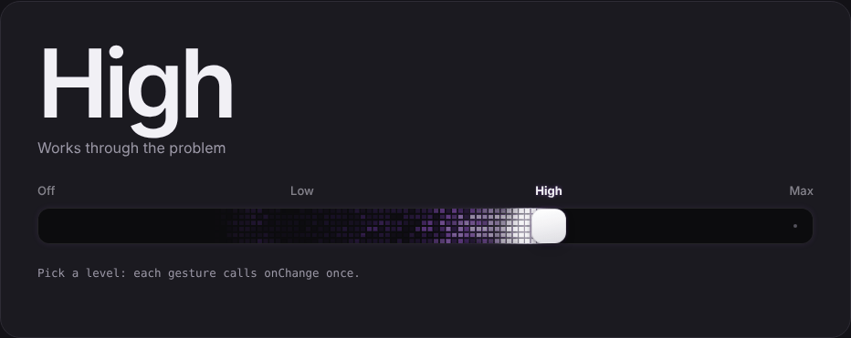

# Effort Slider Core(日本語)

モデルにどれだけ考えさせるかを選ぶためのスライダーです。エージェントツールにそのまま
組み込めるように作っています。レベルを選ぶことは、レール上の出来事です。火がセルからセルへ
燃え移る、信号が拍を打ち始める、霜が広がる。低いレベルでは少しだけ、最上位ではレール全体。
下げると退いて、消えます。



英語版の詳しい説明は [README.md](README.md)、仕組みの解説は
[docs/DESIGN.md](docs/DESIGN.md) にあります。

## 特長

- **フレームワーク非依存。** `createEffortSlider(element, options)` ひとつで動きます。
  React コンポーネントと `<effort-slider>` カスタム要素は薄いラッパーです。
- **1 ジェスチャーにつき 1 回のコミット。** ドラッグ中はプレビューだけで、`onChange` は
  指を離したときに 1 回だけ呼ばれます。非同期でもよく、`false` を返せば元の位置に戻ります。
- **炎は模様ではなく出来事。** レベルが変わるたびに、始まり・経過・終わりがあります。
- **依存なし。** サーバー、アカウント、テレメトリは一切ありません。

## 考え方

見た目は、Claude Code のエフォートスライダーと、それを研究したオープンソース
[claude-range-slider](https://github.com/254558/claude-range-slider)
(のちに [vue-effort-slider](https://www.npmjs.com/package/vue-effort-slider) としてパッケージ化)
から来ています。どちらのコードも含まず、Anthropic との提携や承認もありません。
受け継いだのは、あの効果を美しくしている考え方で、それを決まりとして書き出しました。

1. **光は出来事。** 理由なく動くものはありません。レベルが選ばれる、サムが動かされる、
   そこで何かが始まります。
2. **セル一つひとつが個体。** 応える瞬間、速さ、位相がセルごとに違います。
   隣と同じ動きをするセルはなく、その群れが形を作ります。だからランダムに見えて、まとまって見えます。
3. **先端が一番生きている。** 変化が起きている場所の光が一番強く、届いたら落ち着きます。
4. **源には鼓動がある。** サムから何かが送り出され、伝わっていきます。
5. **色は温度。** 生まれたばかりの光は白く、冷えると色相へ、冷たいところは暗い。
   かすかなセルは「冷たいセル」であって、灰色にはなりません。
6. **光は残る。** 毎フレーム前の光が少し残るので、動きが息づかいとして感じられます。
7. **光るのは熱いところだけ。**
8. **コントロール全体がひとつの瞬間。** 選ばれたレベル名が下からせり上がり、同じ光でほのかに光ります。
9. **何も飛ばない。** 操作中は速く、終わると落ち着く、というテンポの変化は動きを滑らかに曲げるだけで、
   動きをリセットしません。動くものはすべて積分した一つの時計で動き、フレームも間引きません。

どのプリセットでも、エフォートは「出来事がレールのどこまで届くか」です。下げることも出来事で、
光は遠い端からセルごとに退き、離れたセルが一つずつ手放していきます。途中で気が変わっても、
その場所から向きを変えます。

## 派生

この決まりは炎に限りません。プリセットはそれぞれ別の自然現象を通して同じ決まりを読み直したもので、
色違いではなく、振る舞いそのものが違います。

| プリセット | 現象 | 出来事 | 個体 | 先端 | 鼓動 |
| --- | --- | --- | --- | --- | --- |
| `flame` | 炎 | レールに火がつく | セルごとに火がつく時が違う | 燃える縁と、その先の火の粉 | 炎の中を伝わる拍 |
| `ember` | 熾火 | 同じ炎を低く暖かく | 大きなセル、長い残光 | ゆっくりした縁 | ゆっくりした拍 |
| `synapse` | 神経 | 源が拍を打つ | セルは偶然で拍を伝えるので、拍ごとに経路が違う | 拍が途絶える所でぴくつくセル | 拍そのもの |
| `frost` | 霜 | 冷気が広がる | 結晶ごとに密度が違い、自分の時にきらめく | 細く白い凍結線と、その先の針 | ゆっくりした冷たい息 |
| `plankton` | 夜光虫 | 水がかき乱される | 一匹ずつ自分のしきい値でだけ応える | うねり | 源からのうねりと、サム自身の航跡 |

## 試す

`demo.html` を開くだけです(Windows は `demo.bat`)。1 ファイルで完結しています。
同じページは <https://wsl043.github.io/effort-slider-core/> でも見られます。

## 使い方

ESM 専用です(`import` のみ、`require` 不可)。素の JavaScript なので、ビルドも
JSX トランスフォームも要りません。

```js
import { createEffortSlider, LEVEL_SETS } from 'effort-slider-core'

const slider = createEffortSlider(document.querySelector('#effort'), {
  levels: LEVEL_SETS.quad,   // Off, Low, High, Max
  value: 'high',
  preset: 'flame',
  onChange: async (id, level) => {
    // ジェスチャーごとに 1 回。false を返す(または throw する)と元に戻ります。
    return saveEffort(id)
  },
})
```

React:

```jsx
import { EffortSlider } from 'effort-slider-core/react'

<EffortSlider levels={['off', 'low', 'high', 'max']} value={effort} preset="synapse"
  onChange={async id => { const ok = await saveEffort(id); if (ok) setEffort(id); return ok }} />
```

カスタム要素:

```html
<effort-slider levels="low,medium,high" value="medium" preset="ember"></effort-slider>
```

## モデル API につなぐ

スライダーは特定のプロバイダーを知りません。レベルに好きなフィールドを持たせて、
`onChange` で読み出してください。

```js
const levels = [
  { id: 'off',  name: 'Off',  request: {} },
  { id: 'low',  name: 'Low',  request: { effort: 'low' } },
  { id: 'max',  name: 'Max',  request: { thinkingBudget: 32000 } },
]
createEffortSlider(host, { levels, onChange: (id, level) => { nextRequestExtras = level.request } })
```

`request` の中のフィールド名は例です。effort の列挙値や thinking budget の名前は
プロバイダーやモデルのバージョンごとに違うので、実際の値は各社の最新ドキュメントで
確認してください。

## プリセット

既定は `flame` です。WebGL を使いたくない場所では `render: 'css'` で、同じ配色のグラデーションになります。

ブランドカラー 1 色で配色する場合:

```js
createEffortSlider(host, { preset: 'flame', accent: '#e11d48' })
```

## 主なオプション

| オプション | 既定 | 内容 |
| --- | --- | --- |
| `levels` | `LEVEL_SETS.quad` | 低い順のレベル。id 文字列だけでも可。 |
| `value` | 先頭 | 選択中のレベル id。 |
| `preset` | `'flame'` | プリセット id またはオブジェクト。 |
| `accent` | | ブランドカラー(`#rrggbb`)。 |
| `theme` | `'auto'` | `'light'` / `'dark'` / `'auto'`。 |
| `size` | `'md'` | `'sm'` / `'md'` / `'lg'`。 |
| `render` | `'auto'` | `'css'` で WebGL を使わない。 |
| `motion` | `'auto'` | `'still'` で静止画。`auto` は OS の「視差効果を減らす」に従う。 |
| `onChange` / `onInput` / `onReject` | | コミット / プレビュー変更 / 拒否後。 |

全オプションは [README.md](README.md#options) を参照してください。

## 開発

```sh
npm install
npm test         # Node だけで動くテスト 36 件
npm run build    # demo.html と dist/ を生成
```

## ライセンス

MIT
