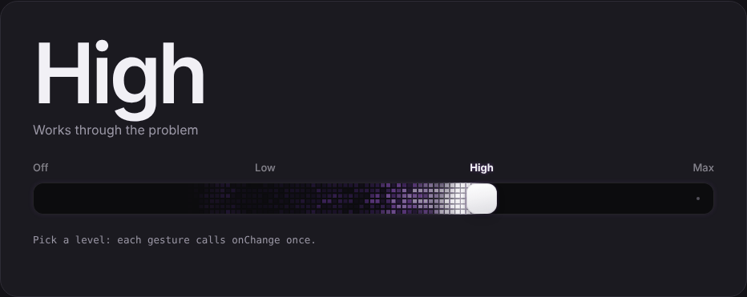
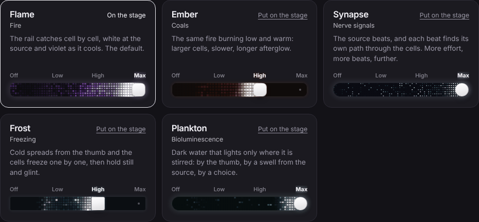
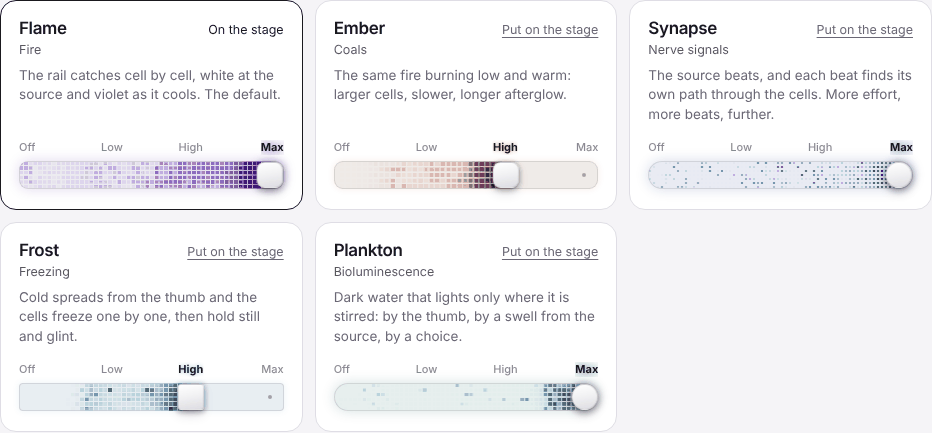

# Effort Slider Core

A slider for choosing how hard a model should think, built to be dropped into
agent tools. Choosing a level is an event on the rail: a fire catches cell by
cell, or a signal starts to beat, or frost spreads. A little at the low end,
the whole rail at the top. Lower it, and it recedes and goes out.



- **Framework-free.** One function, `createEffortSlider(element, options)`.
  A React component and an `<effort-slider>` custom element wrap it.
- **One commit per gesture.** Dragging previews locally. Your `onChange` runs
  once, may be async, and may refuse; a refusal rolls the thumb back.
- **Light is an event, not a pattern.** Every change of level has a
  beginning, a course and an end. Off is exactly empty.
- **No dependencies.** No server, no account, no telemetry. About 49 kB
  minified for everything, shaders included.

## The idea

The look comes from the effort slider in Claude Code and from an open-source
study of it,
[claude-range-slider](https://github.com/254558/claude-range-slider), later
packaged as [vue-effort-slider](https://www.npmjs.com/package/vue-effort-slider).
This project contains no code from either and is not affiliated with or
endorsed by Anthropic. What it keeps is what makes that effect beautiful,
written down as rules:

1. **Light is an event.** Nothing on the rail moves without a reason. A level
   is chosen, or the thumb is moved, and something starts.
2. **Every cell is an individual.** Each has its own moment, its own speed,
   its own phase. No cell does what its neighbour does, and the crowd draws
   the shape. That is why it looks random and still holds together.
3. **The front is the most alive part.** Where the change is happening, the
   light is strongest; once it arrives, it settles.
4. **The source has a pulse.** Something leaves the thumb and travels.
5. **Colour is temperature.** Fresh light is white, it cools to the hue, and
   cold is dark. A faint cell is a cool cell, never a grey one.
6. **Light lingers.** Each frame keeps some of the last, so motion reads as
   breathing.
7. **Only what is hot glows.**
8. **The whole control is one moment.** The level's name rises into place and
   glows with the same light.
9. **Nothing jumps.** Tempo changes (faster while you act, calmer after) bend
   the motion; they never reset it. Every moving thing runs on one integrated
   clock, and every frame is drawn.

Effort, in every preset, is how far the event runs along the rail. Lowering it
is an event too: the light recedes cell by cell from the far end, and the cells
it leaves let go one at a time. A change of mind turns it around from wherever
it is.

## Derivations

The rules are not tied to fire. Each preset reads them through a different
natural phenomenon, so each one behaves differently, not just in another
colour:

| Preset | Phenomenon | The event | The individuals | The front | The pulse |
| --- | --- | --- | --- | --- | --- |
| `flame` | Fire | The rail catches | Each cell catches on its own time | The burning edge, with sparks ahead | Beats along the fire |
| `ember` | Coals | The same fire, low and warm | Larger cells, longer afterglow | A slower edge | Slower beats |
| `synapse` | Nerve signals | The source beats | Each cell passes a beat on by chance, so every beat takes its own path | Cells twitching where beats die out | The beat itself |
| `frost` | Freezing | Cold spreads | Each crystal has its own density and glints at its own moment | A thin white freezing line, with needles ahead | A slow cold breath |
| `plankton` | Bioluminescence | The water is stirred | Each organism answers only above its own threshold | The swell | Swells from the source; the thumb's own wake |

## See it

Open **`demo.html`** (on Windows, double-click `demo.bat`). It is one
self-contained file and runs from disk. The same page is served at
<https://wsl043.github.io/effort-slider-core/>.

## Use it

```sh
npm install effort-slider-core   # once published; until then, install from the Git URL
```

The package is ESM only (`import`, no `require`) and ships plain JavaScript, so
no build step or JSX transform is needed.

```js
import { createEffortSlider, LEVEL_SETS } from 'effort-slider-core'

const slider = createEffortSlider(document.querySelector('#effort'), {
  levels: LEVEL_SETS.quad,          // Off, Low, High, Max
  value: 'high',
  preset: 'flame',
  onChange: async (id, level) => {
    // Called once per gesture. Return false (or throw) to roll back.
    return saveEffort(id)
  },
})

slider.update({ preset: 'ember', theme: 'dark' })
slider.destroy()
```

### React

```jsx
import { EffortSlider } from 'effort-slider-core/react'

<EffortSlider
  levels={['off', 'low', 'high', 'max']}
  value={effort}
  preset="synapse"
  onChange={async id => {
    const ok = await saveEffort(id)
    if (ok) setEffort(id)
    return ok
  }}
/>
```

The package ships plain JavaScript (no JSX), and React is an optional peer
dependency: you only need it for this entry.

### Custom element

```html
<effort-slider levels="low,medium,high" value="medium" preset="ember"></effort-slider>

<script type="module">
  import { defineEffortSlider } from 'effort-slider-core/element'
  defineEffortSlider()

  document.querySelector('effort-slider').addEventListener('change', event => {
    console.log(event.detail.id)   // event.preventDefault() refuses the change
  })
</script>
```

### No bundler

`npm run build` writes `dist/effort-slider.js` (ES module) and
`dist/effort-slider.global.js` (classic script, global `EffortSlider`).

## Wiring it to a model call

The slider knows nothing about any provider. It hands you the level the person
chose; you map that to whatever your model API takes. Put the mapping in the
level itself and read it back in `onChange`:

```js
const levels = [
  { id: 'off',  name: 'Off',  hint: 'Answers straight away',   request: {} },
  { id: 'low',  name: 'Low',  hint: 'A brief check',            request: { effort: 'low' } },
  { id: 'high', name: 'High', hint: 'Works through the problem', request: { effort: 'high' } },
  { id: 'max',  name: 'Max',  hint: 'Takes as long as it needs', request: { thinkingBudget: 32000 } },
]

createEffortSlider(host, {
  levels,
  value: settings.effort,
  onChange: (id, level) => {
    settings.effort = id
    settings.requestExtras = level.request   // merged into the next model request
  },
})
```

The field names inside `request` above are placeholders. Effort enums and
thinking budgets are named differently by each provider and change between
model versions, so take the real parameter names and allowed values from your
provider's current documentation.

`effort-slider-core/core` has no DOM in it, so a server can import
`normalizeLevels` and `LEVEL_SETS` to validate a saved level id.

## Options

| Option | Type | Default | Meaning |
| --- | --- | --- | --- |
| `levels` | `(string \| { id, name?, hint?, intensity?, ... })[]` | `LEVEL_SETS.quad` | The scale, lowest first. Fewer than two usable levels shows `emptyText`. |
| `value` | `string` | first level | Id of the selected level. |
| `onChange` | `(id, level) => boolean \| void \| Promise` | | One call per gesture. `false`, a throw, or a rejected promise rolls back. |
| `onInput` | `(id, level) => void` | | The previewed level changed (also mid-drag). Use it for a live readout. |
| `onReject` | `(id, level) => void` | | A refused commit has rolled back. |
| `preset` | preset id or object | `'flame'` | The phenomenon and its material. See [Derivations](#derivations). |
| `accent` | `#rrggbb` | | One brand colour; replaces the preset's palettes. |
| `colors` | `{ dark?, light? }` | | Replace `track` or `ramp` for a theme. Applied after `accent`. |
| `params` | `{ reach, rows, fill, flicker, sparks, persistence, bloom, threshold, gain, glow, speed }` | preset's | Tune it. See [Your own preset](#your-own-preset). |
| `thumb` | `'pill' \| 'orb' \| 'block' \| 'bar'` | preset's | Thumb shape. |
| `theme` | `'auto' \| 'light' \| 'dark'` | `'auto'` | `auto` follows `prefers-color-scheme`. |
| `size` | `'sm' \| 'md' \| 'lg'` | `'md'` | Rail height 22, 28 or 40 px. |
| `labels` | `'top' \| 'bottom' \| 'none'` | `'top'` | Where the level names go. |
| `render` | `'auto' \| 'css'` | `'auto'` | `css` never creates a WebGL context. |
| `motion` | `'auto' \| 'full' \| 'still'` | `'auto'` | `auto` follows `prefers-reduced-motion`. |
| `magnet` | `0`-`1` | `0.5` | How strongly the stops pull during a drag. |
| `disabled` | `boolean` | `false` | |
| `haptics` | `boolean` | `false` | Short vibration when a drag crosses a stop, where supported. |
| `label` / `labelledBy` | `string` | `'Reasoning effort'` | Accessible name, or the id of the element that names the slider. |
| `emptyText` | `string` | English | Shown when there is no usable scale. |

`update(options)` accepts any subset. A key set to `undefined` is ignored; set
it to `null` to restore the default.

## Behaviour worth knowing

- **Commits.** A drag commits on release. A burst of key presses commits once,
  160 ms after the last one, or at once on blur. A label click commits
  immediately. Re-selecting the current level calls nobody.
- **Async and refusal.** While a promise from `onChange` is open, the slider
  is marked busy and the thumb shows a pulsing ring. If the answer is a
  refusal the thumb springs back and the rail shakes once. If a newer gesture
  starts first, the older answer no longer moves the thumb.
- **Controlled or not.** Pass `value` whenever your state changes and the
  slider follows it; never pass it again and the slider keeps its own.
- **Keyboard.** Arrow keys and Page Up/Down step one level; Home and End jump
  to the ends. Arrow directions flip in right-to-left layouts.
- **Motion.** The light keeps living at rest, at full frame rate, and calms
  smoothly after you act. It stops entirely once it is out at Off, off
  screen, or in a hidden tab.
  With reduced motion (or `motion: 'still'`) the thumb jumps and the rail is
  drawn as a single still frame, with no catching or receding. At Off the
  rail is cleared completely.
- **Fallback.** Without WebGL2, after a lost context, or with
  `render: 'css'`, the rail shows a gradient fill built from the same palette.
  Browsers cap live WebGL contexts per page (about 16 in Chrome), so a page
  with many sliders should use `render: 'css'` for the less important ones.
- **Accessibility.** The rail is a `role="slider"` with the level name and
  hint as its value text. Labels inherit the host's text colour and font.
  Forced-colours (high contrast) mode gets a system-colour fill and thumb.

## Presets





`flame` is the default. Where WebGL is unwelcome, `render: 'css'` draws a
gradient from the same palette instead.

### Your brand colour

```js
createEffortSlider(host, { preset: 'flame', accent: '#e11d48' })
```

The rail tint and a four-stop ramp for each theme are derived in OKLCH.

### Your own preset

```js
createEffortSlider(host, {
  preset: {
    id: 'cold-fire',
    extends: 'flame',                   // anything omitted comes from here
    mode: 'fire',                       // 'fire' | 'synapse' | 'frost' | 'plankton'
    params: { rows: 7, sparks: 2, persistence: 0.92 },
    dark:  { track: '#06121c', ramp: ['#062a3a', '#0f8fb0', '#5fd8f0', '#d6f8ff', '#ffffff'] },
    light: { track: '#eaf2f4', ramp: ['#b5e6ee', '#3fb0c8', '#0f7f9a', '#0a556a', '#063444'] },
  },
})
```

| Param | Default | What it does |
| --- | --- | --- |
| `reach` | 1 | How far the light runs at each level; 1 reaches the whole rail at the top |
| `rows` | 6 | Cells across the rail |
| `fill` | 0.72 | How much of its cell a lit square covers |
| `flicker` | 1 | How hard the light shimmers (0-2) |
| `sparks` | 1 | Sparks running along each row, in `fire` (0-3) |
| `persistence` | 0.87 | How much of each frame lingers into the next (0-0.97) |
| `bloom`, `threshold` | 1, 0.55 | Glow, and how hot a cell must be to glow |
| `gain`, `glow`, `speed` | 1, 0.6, 1 | Brightness, light cast outside the rail, time scale |

A ramp runs coldest to hottest. On a dark rail it should end near white,
because light adds up; on a light rail it should end in a deep shade, because
there the hottest light has to be the densest ink.

## Scales

`LEVEL_SETS` has five ready-made scales, each with a hint per level:

| Name | Levels |
| --- | --- |
| `binary` | Off, On |
| `triad` | Low, Medium, High |
| `quad` | Off, Low, High, Max |
| `penta` | Minimal, Low, Medium, High, Max |
| `budget` | Off, 2k, 8k, 16k, 32k, 64k (each carries `budgetTokens`) |

A level's `intensity` (0-1) sets how strong the energy is there. Left out, it
follows an eased curve so the middle of the scale stays calmer than the top.

## The light on its own

`EnergyRenderer` draws the rail and `createCombustion` keeps the time of its
events, with no slider attached. Together they can drive other surfaces: a progress bar, a
"thinking" indicator, a token meter.

```js
import { EnergyRenderer, PRESETS, createCombustion } from 'effort-slider-core'

const fire = createCombustion()
const renderer = EnergyRenderer.create(canvas)   // null without WebGL2
renderer.configure({ mode: 'fire', ramp: PRESETS.flame.dark.ramp, dark: true })
renderer.resize(canvas.clientWidth, canvas.clientHeight)
fire.target(0.8)                                 // light it

let last = performance.now()
let time = 0
requestAnimationFrame(function frame(now) {
  const dt = (now - last) / 1000
  last = now
  time += dt
  fire.advance(dt)
  renderer.render({
    time, dt, level: 0.8,
    head: progress * canvas.clientWidth,
    from: fire.from, to: fire.to, since: fire.since,
  })
  requestAnimationFrame(frame)
})
```

[docs/DESIGN.md](docs/DESIGN.md) explains each rule, each derivation, and how
to derive your own.

## Styling

Classes are namespaced `es-`. Text inherits the host's font and colour. Sizes
are custom properties on `.es-root`:

```css
.my-panel .es-root { --es-h: 32px; --es-radius: 10px; --es-font: 12px; --es-gap: 8px; }
```

The stylesheet is injected into the document on first use. Inside a shadow
root, import `CSS` and add it to that root yourself.

## Files

```
src/core/      levels, colour, presets, fire timing, spring, gesture model (no DOM)
src/render/    WebGL2 renderer and its shaders
src/dom/       the control and its stylesheet
src/react.js   React wrapper          src/element.js   custom element
types/         TypeScript declarations
demo/          demo source            demo.html        built demo
tests/         node --test, no DOM needed
docs/          DESIGN.md and README images
```

## Develop

```sh
npm install
npm test         # 36 tests, plain Node
npm run build    # demo.html and dist/
```

## Coming from 1.x

Version 2 is a rewrite; see [CHANGELOG.md](CHANGELOG.md) for the full list.

| 1.x | 2.0 |
| --- | --- |
| `<EffortSlider>` from `'effort-slider-core'` | from `'effort-slider-core/react'` |
| `efforts={[{ id, name }]}` | `levels` (ids alone are enough) |
| `colors={{ light: { main, base } }}` | `accent="#..."`, or `colors={{ light: { track, ramp } }}` |
| `mode="native"` | `render="css"` |
| `labels={{ effort, empty }}` | `label`, `emptyText` (`labels` now sets label position) |
| `onRejected()` | `onReject(id, level)` |
| `injectStyles()` required | automatic |
| class prefix `nrs-` | `es-` |

## License

MIT. See [LICENSE](LICENSE).
